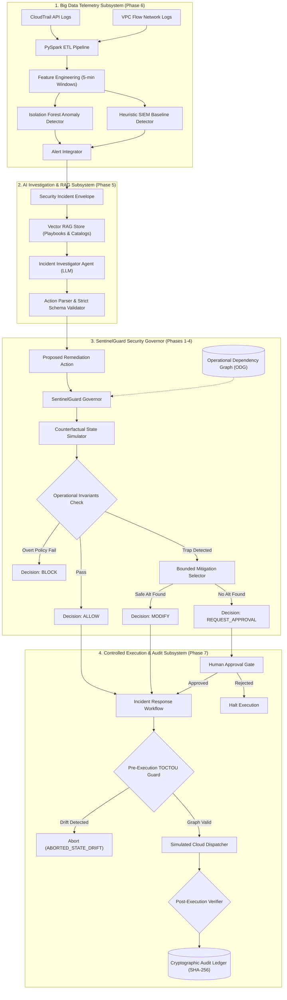
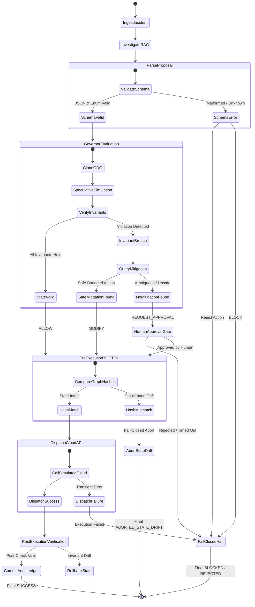

# SentinelGuard: System Architecture & Technical Design

**Document Version**: 1.0.0  
**Project**: SentinelGuard — State-Aware Policy Verification for Safe AI-Driven Cloud Incident Response  
**Implementation Modules**: Phases 1 through 8  

---

## 1. System Overview & Core Architectural Principles

SentinelGuard is a state-aware security governor designed to sit between generative AI incident investigation agents and live cloud infrastructure. It intercepts, verifies, and safely adapts AI-proposed remediation actions before they can impact production environments.

### Core Architectural Principles

1. **State-Aware Counterfactual Reasoning**: Rather than applying static allowlists or single-resource policies, SentinelGuard evaluates actions by simulating their effects on an in-memory Operational Dependency Graph (ODG).
2. **First-Class Operational Invariants**: Formal mathematical invariants govern critical system properties:
   * **$\mathcal{I}_{\text{Admin}}$ (Administrative Recovery)**: Preservation of emergency access paths.
   * **$\mathcal{I}_{\text{Avail}}$ (Service Availability)**: Preservation of target group quorum and healthy replicas.
   * **$\mathcal{I}_{\text{Telem}}$ (Telemetry Continuity)**: Preservation of write and encryption pipelines for audit logging.
3. **Four-Way Decision Engine**: Beyond binary allow/deny, the governor can adapt actions (`MODIFY`) using bounded mitigations or escalate ambiguous actions to humans (`REQUEST_APPROVAL`).
4. **Fail-Closed Execution State-Machine**: Zero actions are dispatched without passing structural schema validation, invariant verification, pre-execution TOCTOU checks, and post-execution confirmation.
5. **Cryptographic Provenance**: Every evaluation, decision rationale, and state delta is permanently committed to a SHA-256 Merkle-linked audit ledger.

---

## 2. End-to-End Pipeline Architecture

The overall system architecture connects eight integrated subsystems, spanning telemetry ingestion to controlled cloud dispatch:



---

## 3. Subsystem Breakdown by Phase

### Phase 1: Core Schemas & Action Catalogue
* **Files**: `src/sentinelguard/core/schemas.py`, `src/sentinelguard/core/actions.py`
* **Role**: Defines strictly validated Pydantic data models for resources (`CloudResource`), actions (`RemediationAction`), invariant results (`InvariantResult`), and decisions (`GovernorDecision`).
* **Key Design Choice**: Hard-coded, immutable `ActionType` enum preventing unauthorized or unknown AWS API calls from being deserialized.

### Phase 2: Operational Dependency Graph (ODG)
* **File**: `src/sentinelguard/core/graph.py`
* **Role**: In-memory directed multigraph implemented on NetworkX.
* **Nodes**: AWS resources categorized by `ResourceType` (EC2, S3, IAM User, Role, KMS Key, Target Group) and `CriticalityTier` (Tier 0 to Tier 3).
* **Edges**: Explicit semantic relationships: `EdgeType.DEPENDS_ON`, `ATTACHED_TO`, `DELIVERS_TO`, `ENCRYPTED_BY`, `MEMBER_OF`, `ROUTES_TO`.
* **Cloning Semantics**: High-speed deep graph cloning ($< 0.1\text{ ms}$) enabling non-destructive speculation.

### Phase 3: Counterfactual State Simulator & Invariant Verifiers
* **Files**: `src/sentinelguard/core/simulator.py`, `src/sentinelguard/core/invariants.py`
* **Role**:
  * Clones the current ODG: $G_{\text{spec}} = \text{Clone}(G)$.
  * Executes the counterfactual mutation on $G_{\text{spec}}$ (e.g., node status set to `quarantined`, edge severed).
  * Evaluates invariant predicates against $G_{\text{spec}}$:
    $$\mathcal{I}_{\text{Admin}}(G') \equiv |\{u \in \text{Admins} \mid \text{ActiveKeys}(u) \lor \text{Console}(u)\}| + |\text{BreakGlassRoles}(G')| \ge 1$$
    $$\mathcal{I}_{\text{Avail}}(G') \equiv \forall tg \in TG: |\{i \in \text{Replicas}(tg) \mid i.\text{status} = \text{running}\}| \ge tg.k_{\text{min}}$$
    $$\mathcal{I}_{\text{Telem}}(G') \equiv \forall t \in \text{Trails}: \text{CanWrite}(t, t.\text{bucket}) \land \text{CanEncrypt}(t, t.\text{kms})$$

### Phase 4: SentinelGuard Governor & Mitigation Engine
* **Files**: `src/sentinelguard/core/engine.py`, `src/sentinelguard/core/mitigations.py`
* **Role**: Coordinates policy checks, counterfactual simulations, and mitigation lookups.
* **Mitigation Catalogue**: If an action violates an invariant, the engine looks up bounded alternatives:
  * Revoking sole admin access key $\to$ Request Human Approval (preserving break-glass access).
  * Terminating/isolating quorum EC2 instance $\to$ Attach Scoped Egress Filter (containing host without breaking load balancer health checks).
  * Removing audit bucket policy $\to$ Scope bucket policy to preserve CloudTrail delivery.

### Phase 5: AI Investigation Agent & Vector RAG Pipeline
* **Files**: `src/sentinelguard/agent/`, `src/sentinelguard/rag/`
* **Role**:
  * Vector store indexing NIST / AWS incident response playbooks and cloud action catalogues.
  * `IncidentInvestigatorAgent` consuming structured `SecurityIncident` envelopes and synthesizing proposed remediations.
  * `ActionParser` enforcing fail-closed JSON schema adherence, neutralizing prompt injection attacks embedded in telemetry logs.

### Phase 6: Big Data Telemetry & ML Anomaly Detection
* **Files**: `src/sentinelguard/telemetry/`
* **Role**:
  * Generates high-fidelity synthetic AWS CloudTrail events and VPC Flow Logs with labeled attack scenarios.
  * Distributed feature aggregation via PySpark over 5-minute sliding windows (error counts, unique IPs, byte throughput, distinct IAM calls).
  * Unsupervised anomaly detection via `Isolation Forest`, paired with an authoritative `HeuristicThresholdDetector` SIEM baseline.
  * `AlertIntegrator` routing high-confidence anomalies to the AI Investigation Agent.

### Phase 7: Controlled Cloud Execution & Audit Workflow
* **Files**: `src/sentinelguard/execution/`
* **Role**:
  * Complete state-machine orchestrating human approval gates, pre-execution TOCTOU checks, cloud API dispatch, and post-execution verification.
  * Pure simulation environment (`SimulatedCloudEnvironment`) preventing inadvertent live AWS mutations.
  * Cryptographic SHA-256 audit ledger with Merkle linking (`ExecutionAuditLedger`).

### Phase 8: Benchmarking & Reproducibility Suite
* **Files**: `src/sentinelguard/benchmark/`, `run_experiments.py`
* **Role**:
  * CloudGuard-Bench (120 scenarios across 4 baselines).
  * Extended Adversarial Suite (24 scenarios across 12 vulnerability classes).
  * Telemetry detection comparison (Isolation Forest vs SIEM).
  * `ReproducibleExperimentRunner` capturing complete system and dependency metadata and outputting machine-readable JSON artifacts.

---

## 4. State-Machine Transitions & Decision Logic

The following state diagram details the precise lifecycle transitions of an incident remediation proposal:



---

## 5. Security & Trust Boundaries

```
+---------------------------------------------------------------------------------------+
| SentinelGuard Trust Boundary Architecture                                             |
+--------------------------+-----------------------+------------------------------------+
| Component                | Trust Level           | Security Controls                  |
+--------------------------+-----------------------+------------------------------------+
| External Security Logs   | Untrusted (Hostile)   | Sanitized & Ingested via PySpark   |
| LLM Agent Output         | Untrusted (Adversarial)| Pydantic Parser & Action Whitelist|
| SentinelGuard Governor   | Trusted Core          | Deterministic Invariant Simulator  |
| Human Approval Gate      | Privileged Authority  | Multi-signature / Quorum Token     |
| Cloud Dispatcher         | Enforcing Boundary    | Simulation Guardrail / AWS SDK     |
| Audit Ledger             | Immutable Record      | SHA-256 Merkle Chain Verification  |
+--------------------------+-----------------------+------------------------------------+
```

1. **Untrusted Agent Boundary**: The LLM is strictly treated as an unprivileged, potentially adversarial advisor. It possesses zero execution capabilities; all recommendations must be validated by the Governor.
2. **Deterministic Invariant Boundary**: Invariant checks do not query an external model; they execute deterministic graph algorithms and relational queries directly against the ODG.
3. **Execution Guardrail**: Hard-coded safety assertions prevent execution if any network calls to real AWS endpoints are detected during testing.
